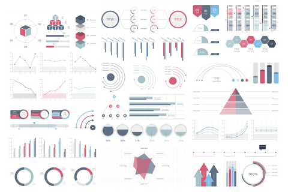

Portfolio
=========

Programming Projects
--------------------

*For access to my private project repositories, please [email me](mailto:ejhughes@student.csuniv.edu?subject=GitHub%20Access) with the subject line, GitHub Access.

---
### [Inventory-Management | CSCI 325](project1)

---
### [Warfighter Foundation Website | CSCI 334](project2)

---
### [ForeCite | CSCI 495](project3)

---
### [Windows Security Hardening Toolkit | CSCI 301](project4)

---

Ethics Papers
-------------

### [Ethical Considerations in Software Reliability](/pdf/sample_presentation.pdf)

-   **Class: CSCI 315**  
-   **Grade: 100%**

### [Copyright and Ethics in Code Production](/pdf/sample_presentation.pdf)

-   **Class: CSCI 301** 
-   **Grade: 87.5%**

### [The Ethical Dilemmas in Cybersecurity](/pdf/sample_presentation.pdf)

-   **Class: CSCI 325** 
-   **Grade: 100%**

---

Presentations
-------------

### [Inventory Management Project Presentation](https://www.youtube.com/watch?v=dZUN16w6otI)

- **Class: CSCI 325** 
- **Grade: 100%**

### [UIP Final Project Presentation](https://www.youtube.com/watch?v=jY-luKzs8Do)

- **Class: CSCI 334** 
- **Grade: 100%**

---

Page template forked from <a href="https://github.com/csu-cs/csci-portfolio">CSU-CS</a>

<!-- Remove above link if you don't want to attributive -->
