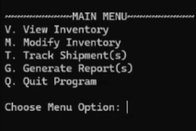
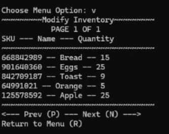
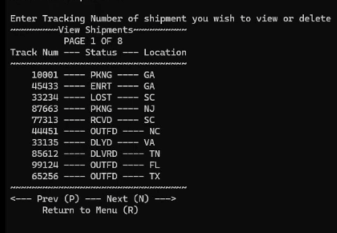
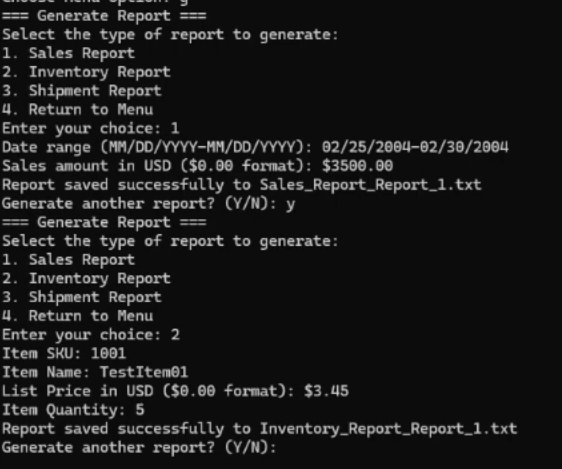

[Back to Portfolio](./)

# Inventory Management System

- **Class:** CSCI 325
- **Grade:** A
- **Language(s):** Java (Java 21)
- **Source Code Repository:** [Inventory Management](https://github.com/hughesevan/Inventory-Management)

  Please [email me](mailto:ejhughes@student.csuniv.edu?subject=GitHub%20Access) to request access to the private repository.

## Project Description

The Inventory Management System is a Java-based command-line application developed for CSCI 325. The project was created to help users manage inventory records, track shipments, and generate reports through a menu-driven interface.

The application allows users to view existing inventory, add new items, modify item information, and remove items using their Stock Keeping Unit (SKU) numbers. Each inventory item contains information such as its name, description, SKU, quantity, and cost. The program also supports importing inventory records from text files and saving inventory information for later use.

In addition to inventory management, the application includes shipment tracking and report generation. Users can view shipment information, select shipments using tracking numbers, and remove shipment records. The report generation feature allows users to create sales, inventory, and shipment reports that are saved as text files.

The project demonstrates object-oriented programming, file input/output, data management using Java collections, and user input validation. It was developed collaboratively by Gabriel Tirado, Evan Hughes, and Andrew Taylor.

## How to Compile and Run the Program

The application was developed using Java and Apache NetBeans. The repository contains a NetBeans project configured for Java 21.

**Requirements:**

- Java Development Kit (JDK) 21
- Apache NetBeans IDE with Java support

**Instructions:**

1. Download or clone the private GitHub repository.
2. Open Apache NetBeans.
3. Select **File → Open Project**.
4. Navigate to the `InventoryManagmentSystem` folder and open the project.
5. Ensure that JDK 21 is selected as the project's Java platform.
6. Select **Run → Run Project** to compile and launch the application.
7. The program will display its main menu in the output console.

The application's main class is `csu.csci325.InventoryManagment`.

The NetBeans project also includes an Ant build configuration. Once the project has been successfully built, its configured JAR output is `dist/InventoryManagmentSystem.jar`.

## UI Design

The Inventory Management System uses a command-line interface with text-based menus. Users navigate the application by entering letters corresponding to menu options or numbers identifying specific records.

### Main Menu

When the program starts, users are presented with five options:

- **V:** View Inventory
- **M:** Modify Inventory
- **T:** Track Shipments
- **G:** Generate Reports
- **Q:** Quit Program

The application continues displaying the main menu until the user chooses to quit.

**Fig. 1.** Main menu displaying the inventory management, shipment tracking, and report generation options.

### Viewing and Modifying Inventory

The inventory interface displays items with their SKU numbers, names, and quantities. Inventory records are organized into pages containing up to ten items.

Users can navigate between pages, select individual items using their SKU numbers, and view additional information.

The modification menu allows users to add inventory items manually, import records from files, clear the inventory, and save inventory records. Individual items can also be selected for editing or deletion.

**Fig. 2.** Inventory interface displaying stored items and their SKU numbers, names, and quantities.

### Shipment Tracking

The shipment tracking feature displays shipment records with their tracking numbers, current statuses, and locations.

Users can navigate through shipment records, enter a tracking number to view a specific shipment, and remove shipments after confirming the action.

Shipment information is maintained using file-based storage.

**Fig. 3.** Shipment tracking interface displaying shipment information and navigation options.

### Report Generation

The report generation feature allows users to create three types of reports:

- **Sales Reports:** Records a date range and sales amount.
- **Inventory Reports:** Records item information, pricing, and quantity.
- **Shipment Reports:** Records shipment numbers and status updates.

The program prompts users for the required information and validates certain input formats, including dates, currency amounts, and numeric quantities.

Generated reports are saved as text files with filenames based on their report types.

**Fig. 4.** Report generation menu allowing users to select sales, inventory, or shipment reports.

## Additional Considerations

This project provided experience developing a larger Java application with multiple classes responsible for different parts of the program. The application uses object-oriented programming principles to organize inventory records, shipment information, and reporting functionality.

The project also demonstrates file handling through reading and writing inventory records and generating reports. Input validation and confirmation prompts are used for several user interactions, including record deletion and report creation.

Potential improvements include a graphical user interface, more comprehensive error handling, and replacing text-file storage with a database for larger inventories.

[Back to Portfolio](./)
