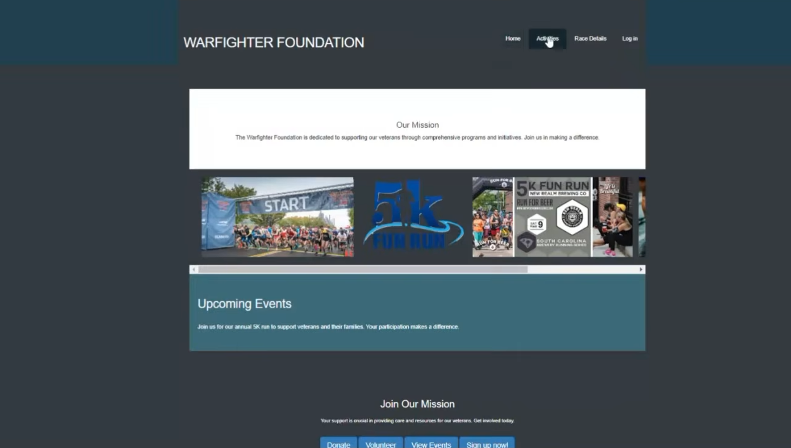
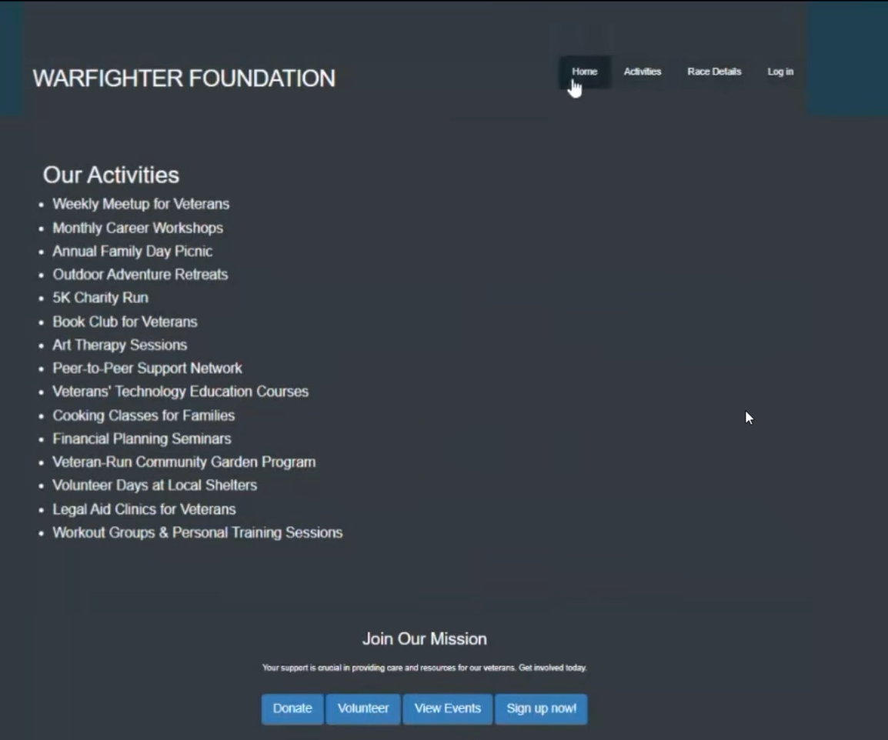
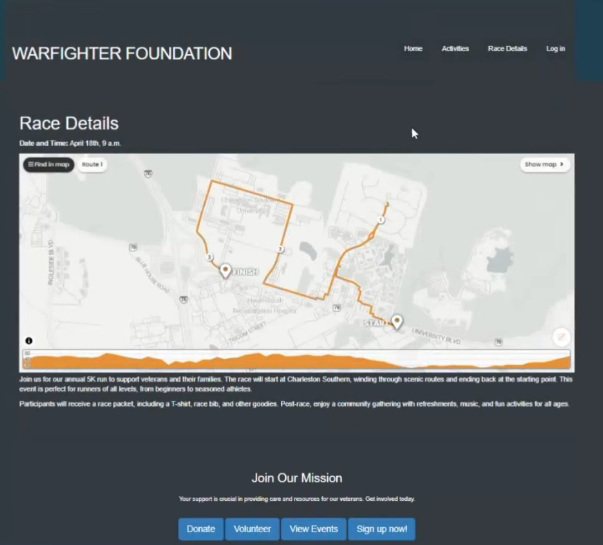
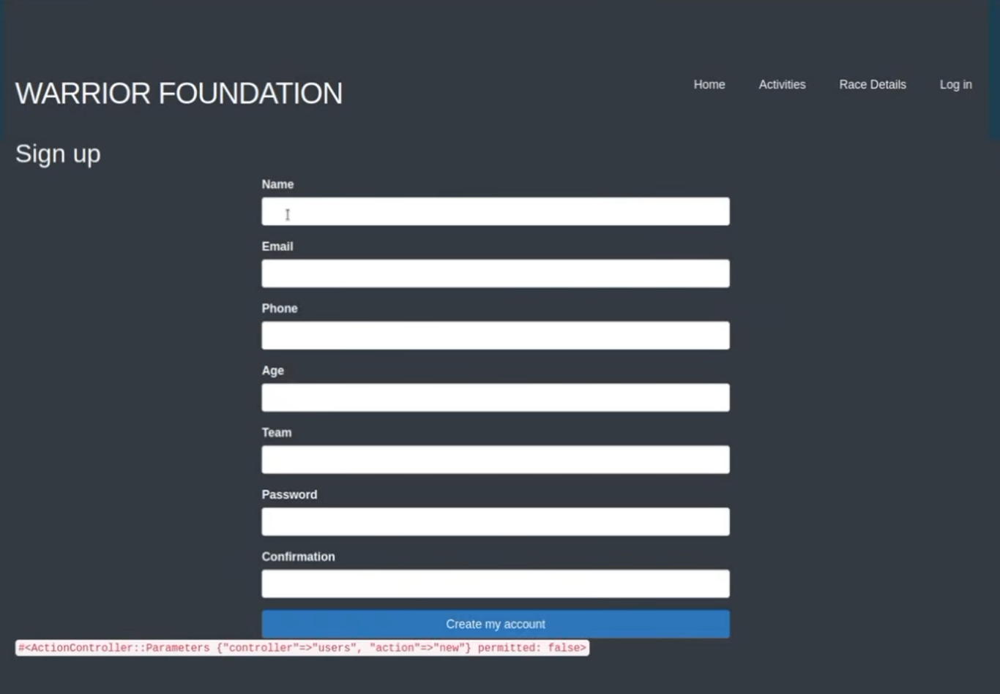

[Back to Portfolio](./)

# Warfighter Foundation Website

- **Class:** CSCI 334
- **Grade:** 100%
- **Language(s):** Ruby, HTML, CSS/SCSS, JavaScript
- **Framework:** Ruby on Rails 7.0.8
- **Database:** SQLite
- **Source Code Repository:** [Warfighter Foundation Website](https://github.com/adamrt918/UIP_FinalProj)

  Please [email me](mailto:ejhughes@student.csuniv.edu?subject=GitHub%20Access) to request access to the private source code repository.

## Project Description

The Warfighter Foundation Website was developed as a group project for CSCI 334. The goal was to create a functional website promoting a charity 5K event and supporting the Warfighter Foundation's mission of helping veterans and their families.

The website was developed using Ruby on Rails, with HTML, SCSS, JavaScript, and Bootstrap for its frontend design. SQLite was used to store user account information.

The application includes a homepage explaining the foundation's mission, an activities page highlighting veteran-focused programs, and a race details page featuring information about the charity 5K event. The race details page also includes an embedded interactive map showing the race route.

In addition to its informational pages, the website supports user registration, login, logout, and profile management. Users can create accounts using their personal information, including their name, email, age, phone number, and team. Passwords are handled using Rails' secure password functionality.

The project demonstrates full-stack web development, database integration, user authentication, and the use of the Model-View-Controller (MVC) architecture.

## How to Run the Program

The application is a Ruby on Rails website and must be run using a local Rails development server.

**Requirements:**

- Ruby 3.1.2
- Ruby on Rails 7.0.8
- Bundler
- SQLite
- Required Ruby gems listed in the Gemfile

**Instructions:**

1. Download or clone the project repository from GitHub.
2. Open a terminal in the project's root directory.
3. Install the required Bundler version and project dependencies.

```bash
gem install bundler -v 2.3.14
bundle _2.3.14_ config set --local without 'production'
bundle _2.3.14_ install
```

4. Set up the database.

```bash
rails db:migrate
```

5. Optionally run the application's test suite.

```bash
rails test
```

6. Start the Rails development server.

```bash
rails server
```

7. Open a web browser and navigate to:

`http://localhost:3000`

The website should display the Warfighter Foundation homepage.

## UI Design and Program Functionality

The website uses a graphical interface designed to help visitors learn about the foundation, explore available activities, and access information about its charity 5K event.

Navigation links allow users to move between the homepage, activities page, race details page, and account-related features.

### Homepage

The homepage introduces the Warfighter Foundation and its mission of supporting veterans. It includes a mission statement, a gallery of event-related photographs, information about the annual 5K charity run, and links encouraging visitors to become involved.

The page also provides access to account registration and the website's other sections.



**Fig. 1.** Homepage displaying the Warfighter Foundation mission, image gallery, and event information.

### Activities Page

The activities page lists programs and events intended to support veterans and their families. These include community meetups, career workshops, outdoor activities, educational programs, and volunteer opportunities.

This page helps visitors understand the types of services and community involvement promoted by the foundation.



**Fig. 2.** Activities page displaying programs and events available to veterans and their families.

### Race Details and Map

The race details page provides information about the foundation's annual 5K event, including its starting location, planned activities, and event information.

An embedded race map allows visitors to view the course. The page also includes links encouraging visitors to register and explore other foundation activities.



**Fig. 3.** Race details page displaying event information and the embedded race route map.

### User Registration and Authentication

The application includes a user account system that allows visitors to register and log in.

During registration, users provide their name, email address, age, phone number, team, and password. The application validates user information before creating an account.

Registered users can log in to access their profiles, and the application provides functionality for updating account information and resetting passwords.

The authentication system uses Rails sessions and secure password handling to manage user access.



**Fig. 4.** User registration page displaying the form for creating a new account.

## Additional Considerations

Developing this project provided experience working with a full-stack web application and integrating several technologies into a single system.

Ruby on Rails was used to organize the application through its Model-View-Controller architecture. Controllers handle user requests, models manage user information and validation, and views display website content.

The project also demonstrates the use of database migrations, session management, responsive styling, and embedded third-party content.

Potential improvements include expanding the event registration functionality, improving mobile accessibility, and adding more administrative tools for managing events and participants.

[Back to Portfolio](./)
