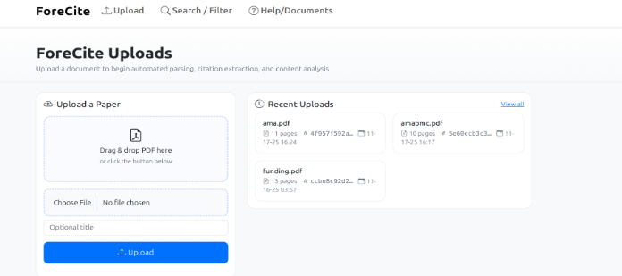
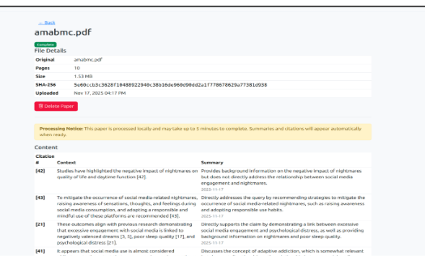
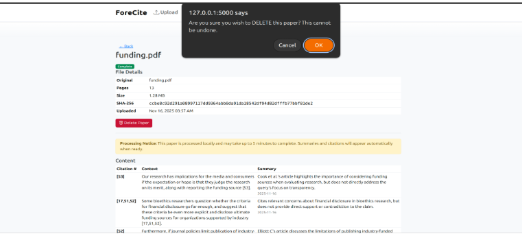

[Back to Portfolio](./)

# ForeCite — Research Paper Citation Extractor

- **Class:** CSCI 495
- **Grade:** A
- **Language(s):** Python, HTML, CSS, JavaScript
- **Framework:** Flask
- **Database:** SQLite with SQLAlchemy
- **Source Code Repository:** [ForeCite](https://github.com/csu-cs/csci495-Fall25-blueTeam-citationParser/tree/master)

  Please [email me](mailto:ejhughes@student.csuniv.edu?subject=GitHub%20Access) to request access to the source code repository if needed.

## Project Description

ForeCite is a web-based research paper citation extraction and analysis application developed as a group project for CSCI 495 at Charleston Southern University. The project was designed to assist researchers and students at the Medical University of South Carolina (MUSC) by reducing the time required to manually identify, organize, and evaluate citations in academic research papers.

The application allows users to upload research papers in PDF format, automatically identify numbered citations, and extract the surrounding text that provides context for each citation. It then uses a locally hosted large language model through Ollama to generate short explanations of how the citations relate to the statements made in the paper.

ForeCite was developed primarily in Python using the Flask web framework. PyMuPDF is used for PDF text extraction, while custom parsing functions identify citation markers and match them to entries in the reference list. The application uses SQLAlchemy and SQLite to store uploaded papers, citations, contexts, and generated summaries.

The project demonstrates full-stack development, database design, PDF processing, regular expressions, local AI integration, and the use of the Systems Development Life Cycle (SDLC).

## How to Run the Program

ForeCite is a Python web application that runs through a local Flask development server. The citation analysis functionality also requires a locally running Ollama service.

**Requirements:**

- Python 3.10 or newer
- pip
- Python dependencies listed in `requirements.txt`
- Ollama
- A compatible local Llama model

**Instructions:**

1. Download or clone the ForeCite repository.
2. Open a terminal in the project's root directory.
3. Create and activate a Python virtual environment.

```bash
python -m venv venv
```

On Windows:

```bash
venv\Scripts\activate
```

4. Install the required Python packages.

```bash
pip install -r requirements.txt
```

5. Install Ollama and download the model configured in the backend.

```bash
ollama pull llama3.2:3b
```

6. Ensure the Ollama service is running.
7. Start the Flask application from the project's root directory.

```bash
python frontend/app.py
```

8. Open a web browser and navigate to:

`http://127.0.0.1:5000`

The application creates its SQLite database tables when initialized and uses a local uploads directory to store submitted PDF files.

## UI Design and Program Functionality

ForeCite uses a browser-based interface that allows users to upload research papers, review citation analysis results, search previously processed documents, and manage stored papers.

### Homepage and PDF Upload

The homepage serves as the primary entry point for ForeCite. Users can upload a PDF research paper through the file selection interface.

The application supports an optional document title and checks the uploaded file before storing it. Uploaded documents are registered in the database and processed through the application's backend.

For the implemented citation parser, AMA-style research papers with bracketed numerical citations produce the most reliable results.



**Fig. 1.** ForeCite homepage displaying the research paper upload interface.

### Citation Extraction and Processing

After a paper is uploaded, the application extracts its text using PyMuPDF.

The citation parser searches for numbered references such as `[1]`, `[2,3]`, and `[4-6]`. It identifies the surrounding text, locates the corresponding entries in the paper's reference list, and organizes the extracted information.

The application processes papers in a background thread and maintains processing status information in its database.


**Fig. 2.** ForeCite displaying an uploaded research paper and its processing status.

### AI Citation Analysis

ForeCite integrates with Ollama to analyze extracted citations using a locally hosted language model.

The system sends citation information, surrounding context, and reference details to the model. The model is instructed to explain how each citation supports, contradicts, or provides background for the statement in which it appears.

The generated analysis includes a short summary and a relevance rating. These results are saved to the application's database and can be reviewed through the web interface.



**Fig. 3.** Citation analysis results displaying extracted references, context, and AI-generated summaries.

### Search and Document Management

ForeCite includes a search interface for finding previously uploaded research papers.

Users can browse stored documents, open individual paper records, and review their extracted citations and generated summaries.

The application also includes functionality for deleting uploaded papers and their associated records.



**Fig. 4.** Search interface displaying previously uploaded research papers and document management options.

## Additional Considerations

ForeCite provided experience developing a multi-component software application that combines document processing, database storage, and local artificial intelligence.

The backend separates PDF parsing from language model analysis. This design makes the individual components easier to maintain and modify. Flask handles the web interface and application routes, while SQLAlchemy manages the underlying database records.

The project also provided experience working collaboratively on a semester-long software development project involving requirements analysis, system design, implementation, and documentation.

Potential improvements include support for additional citation formats such as APA and MLA, improved handling of complex PDF layouts, more comprehensive validation of AI-generated summaries, and expanded deployment options.

[Back to Portfolio](./)
