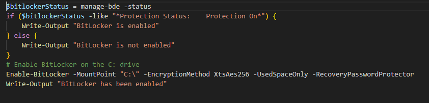
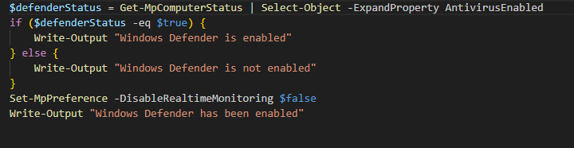
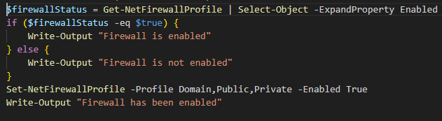
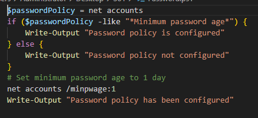
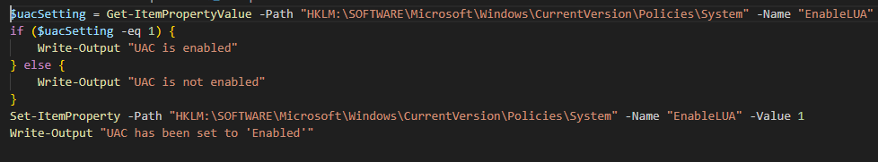

[Back to Portfolio](./)

# Windows Security Hardening Toolkit

- **Class:** CSCI 301
- **Grade:** A
- **Language(s):** PowerShell
- **Source Code Repository:** [Windows Security Hardening Toolkit](https://github.com/hughesevan/Windows-Security-Hardening-Toolkit)

  Please email me to request access to the private GitHub repository.

## Project Description

The Windows Security Hardening Toolkit is a collection of five PowerShell scripts developed for CSCI 301. The project's purpose is to automate common Windows security configuration tasks and demonstrate how scripting can be used to improve system security.

Each script focuses on a different Windows security feature: BitLocker drive encryption, Microsoft Defender Antivirus, Windows Defender Firewall, local password policies, and User Account Control (UAC).

The scripts use built-in Windows commands, PowerShell cmdlets, and registry settings to inspect system configurations and attempt to apply stronger security settings. Together, they demonstrate the use of PowerShell for Windows system administration, security configuration, and task automation.

This project provided practical experience working with operating system security controls and understanding how individual settings contribute to protecting Windows computers.

## How to Run the Program

The toolkit consists of five independent PowerShell scripts that are designed to run on Windows systems.

**Requirements:**

- Windows 10 or Windows 11 with the relevant security features available
- Windows PowerShell 5.1 or a compatible PowerShell environment
- Administrator privileges
- BitLocker support for the encryption script

**Instructions:**

1. Download or clone the GitHub repository.
2. Open the `finalproject` directory.
3. Launch Windows PowerShell as Administrator.
4. Navigate to the folder containing the PowerShell scripts.

   ```powershell
   cd "C:\path\to\finalproject"
   ```

5. Run the desired script using its filename.

   ```powershell
   .\Defender.ps1
   ```

6. Repeat the process for any other security feature you wish to configure.

The available scripts are:

```text
Bitlocker.ps1
Defender.ps1
Firewall.ps1
Password.ps1
UAC.ps1
```

## Program Design and Functionality

Unlike a graphical application, the Windows Security Hardening Toolkit uses a command-line interface. Each script performs a security check, displays a status message, and attempts to apply its corresponding security configuration.

### BitLocker Drive Encryption

The `Bitlocker.ps1` script uses the Windows `manage-bde` utility to inspect BitLocker status. It then attempts to enable BitLocker encryption on the system's C: drive.

The encryption command specifies XTS-AES-256 encryption, encrypts used disk space, and configures a recovery password protector.

This demonstrates how PowerShell can interact with Windows encryption features to help protect stored data.



**Fig. 1.** PowerShell output showing the BitLocker status check and attempted encryption configuration.

### Microsoft Defender Antivirus

The `Defender.ps1` script checks whether Microsoft Defender Antivirus is enabled using `Get-MpComputerStatus`.

It then uses `Set-MpPreference` to set `DisableRealtimeMonitoring` to false, which requests that real-time protection be enabled.

This demonstrates basic antivirus configuration using PowerShell commands.



**Fig. 2.** PowerShell script showing the Microsoft Defender status check and real-time monitoring configuration.

### Windows Defender Firewall

The `Firewall.ps1` script retrieves Windows Firewall profile settings using `Get-NetFirewallProfile`.

It then enables firewall protection across the Domain, Public, and Private profiles using `Set-NetFirewallProfile`.

This script demonstrates how Windows firewall configurations can be managed programmatically.



**Fig. 3.** PowerShell script showing the Windows Firewall status check and configuration.

### Local Password Policy

The `Password.ps1` script uses the Windows `net accounts` command to inspect account policy information.

It then sets the minimum password age to one day using the following command:

```powershell
net accounts /minpwage:1
```

This setting restricts how quickly a password can be changed again. The script demonstrates the use of command-line administrative utilities for managing local account policies.



**Fig. 4.** PowerShell script showing the local password policy check and minimum password age configuration.

### User Account Control

The `UAC.ps1` script checks the `EnableLUA` setting in the Windows registry to determine whether User Account Control is enabled.

The script then sets this value to `1`, requesting that UAC be enabled.

User Account Control helps reduce the risk of unauthorized system changes by requiring appropriate approval or credentials for administrative operations.



**Fig. 5.** PowerShell script showing the UAC registry check and configuration.

## Additional Considerations

The Windows Security Hardening Toolkit demonstrates how scripting can automate repetitive administrative tasks and apply security settings through the operating system.

The project provided experience using PowerShell cmdlets, Windows command-line utilities, and the Windows registry. It also reinforced the importance of permissions and understanding the consequences of modifying system-level configurations.

Possible improvements include adding post-configuration verification, logging, error handling, administrator privilege checks, and a centralized menu for running the scripts together.


[Back to Portfolio](./)
